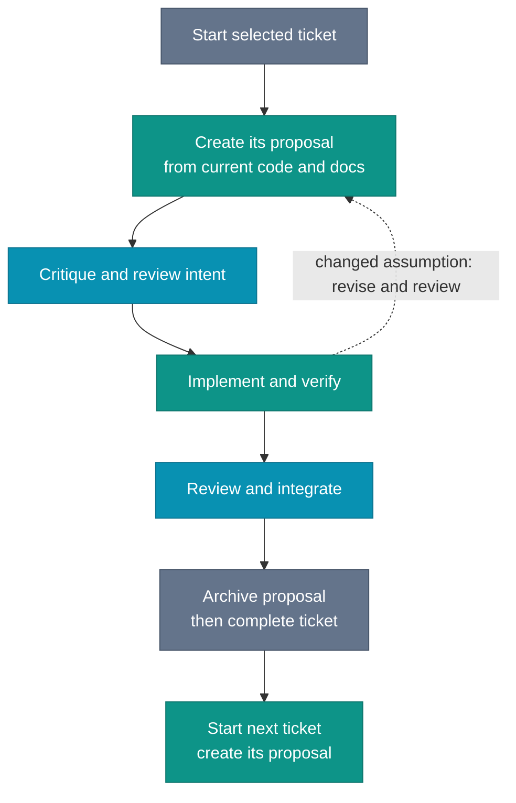

# Spec Lifecycle

An implemented change left among active proposals gives the next agent an ambiguous starting point. Is the work unfinished, or did the developer leave the completion record behind? Keep the proposal's lifecycle aligned with the ticket it implements.

This chapter describes the book's workflow from starting a ticket to archiving its verified change. The ticket convention comes from the author's team practice. OpenSpec provides the change artifacts and archive operation.

## The stages

Start with the selected ticket and the current code and documentation. Resolve governing design decisions before asking the agent to implement them. [OpenSpec in an Existing SDLC](../team/openspec-in-existing-sdlc) explains ownership and the one-to-one ticket mapping.



Write the proposal when the ticket starts. Record the requested behavior, constraints, and acceptance criteria. Use the current repository to resolve implementation questions, including changes colleagues have integrated since the tickets were planned.

Critique and review the intent before implementation. For a decision-heavy change, review the proposal in its own pull request (PR). For a small change kept in one PR, inspect the spec before the generated code. [Code Review for Agent-Generated Code](../team/code-review-agent-code) covers the review inputs and reading order.

During implementation, inspect the generated files and relevant test results against the acceptance criteria. If the code reveals an incorrect assumption, revise the proposal and review the affected requirement before continuing. The agreed sequence allows correction within a ticket.

*Sources: The lifecycle sequence, review order, and changed-assumption rule are this book's workflow synthesis based on the author's ticket-based practice.*

## Writing the task list

OpenSpec keeps implementation steps in `tasks.md` inside the change folder. Review those steps as the execution plan for the current ticket. Team-level splitting belongs before proposal creation, as described in [Why Small?](./why-small).

*Sources: Fission AI, ["Concepts"](https://github.com/Fission-AI/OpenSpec/blob/main/docs/concepts.md) (reviewed October 22, 2026), `tasks.md` as the implementation checklist. The ticket boundary is the author's workflow convention.*

Tell the agent how the project connects implementation tasks to Acceptance Criterion IDs (AC IDs). For example:

```markdown
- Name the AC IDs each implementation task addresses.
- Include the tests needed to verify those criteria.
- State each test's type, such as unit or integration.
- Record unfinished checks instead of marking the task complete.
```

Inspect the resulting task list and evidence. A checked box records the agent's reported progress. Before accepting the work, verify the named tests assert the intended behavior and the diff stays within the ticket's scope.

*Sources: The instruction example and task-review checks are this book's workflow guidance.*

## Critique before implementation

Ask a critic to identify ambiguous acceptance criteria, missing failure behavior, and conflicts with the current design. Supply the ticket, draft proposal, and relevant code or documentation. Review concrete findings against those inputs before changing the spec.

If you use a separate agent session, choose its inputs explicitly. A fresh session or a different model does not establish the quality of the critique. Spend the extra review effort where a mistaken requirement would force substantial rework.

*Sources: The critique inputs and effort tradeoff are this book's workflow guidance.*

## Archive before completing the ticket

In the author's team workflow, a ticket is complete only when the implementation has been verified and integrated and the change proposal is archived. Keep the ticket open while any of those steps remains unfinished. Archive status alone is not evidence of correct behavior.

OpenSpec's archive command preserves the change folder under `openspec/changes/archive/` and offers to sync delta specs that have not already been merged into the main specs. Accept or perform that sync before completing the ticket. Inspect the resulting main specs and keep the archive in version control. The next proposal needs the current specification as well as the integrated code.

Once this ticket is complete, start the next ticket in the agreed sequence and create its proposal. Other developers continue on their own tickets. Recheck dependencies and current decisions before beginning the next implementation.

*Sources: Fission AI, ["Concepts"](https://github.com/Fission-AI/OpenSpec/blob/main/docs/concepts.md) (reviewed October 22, 2026), archive history and delta-spec integration. Ticket completion and the developer's sequence are the author's reported team practice.*

## Tooling

OpenSpec's Commands reference, checked October 22, 2026, uses `/opsx:propose` to generate change artifacts and `/opsx:apply` to implement tasks. `/opsx:sync` merges delta specs into main specs. `/opsx:archive` archives a change and offers synchronization if needed. Invocation syntax varies by agent integration.

*Sources: Fission AI, ["Commands"](https://github.com/Fission-AI/OpenSpec/blob/main/docs/commands.md) (reviewed October 22, 2026), proposal, implementation, synchronization, archive operations, and integration-specific invocation.*

Archiving records the completed change. The next agent still needs the maintained design documents behind it, including decisions affecting more than one ticket.
