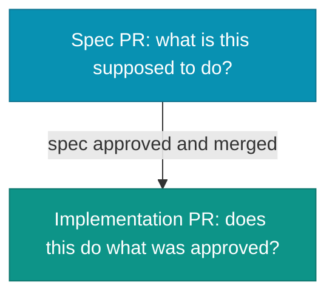

# Code Review for Agent-Generated Code

Open the spec before reviewing the generated diff. If the agent resolved an ambiguous requirement while implementing, the patch alone gives you its chosen answer. You still need to decide whether the team wanted that behavior.

This chapter uses spec-first review, an optional agent-assisted coverage trace, and explicit checks for copied patterns or removed controls. These are the book's review practices, with the reviewer responsible for checking the findings.

## PR shape: review intent before implementation

For a decision-heavy change, put the proposed behavior in a separate pull request (PR) before implementation. Read the acceptance criteria and constraints without a generated solution to explain them away. [Trunk-Based Development with Agents](./trunk-based-development) covers when the two-PR split is worth using.

In the implementation PR, link to the approved spec and identify any subsequent revisions. Review those revisions first. Then compare the code and test evidence with the agreed behavior, including the parts the agent left unfinished.

For a small change kept in one PR, keep the same reading order. The [PR Taxonomy](../quality/pr-taxonomy) helps decide whether unrelated documentation, refactoring, and behavioral changes belong together.

*Sources: The review order and PR guidance are this book's workflow synthesis.*

## Trace the implementation to the spec

Suppose the agent implements duplicate-email rejection, but its new test only checks malformed email. A passing test says nothing about the missing duplicate case. Review the test's setup, action, and assertions against the named acceptance criterion.

For a change with many scenarios, ask a reviewing agent to list each criterion, locate its test, and state what the test asserts. Give it the approved spec, implementation diff, and relevant tests. Request file references for missing coverage, mismatched assertions, and additions outside the agreed scope. Inspect those references before accepting the findings.

For example, `SC-018 names duplicate-email rejection, but the tagged test only supplies a malformed address` directs the reviewer to a specific mismatch. A report saying `coverage looks incomplete` leaves the tracing unfinished.

A separate session lets you choose the review inputs explicitly. Include relevant architecture decisions and existing code needed to assess the patch. Do not treat a fresh session or a different model as proof of independent judgment. For a small change, tracing the criteria yourself avoids an extra report to verify.

*Sources: The coverage trace, example, and choice of review inputs are this book's workflow guidance.*

## Check copied patterns and removed controls {#patterns-and-controls}

A matching pattern in the repository is not enough reason to accept generated code. Suppose the agent copies an endpoint whose authorization check the team has already identified as incomplete. Compare the new endpoint with the approved authorization design and verify the relevant rejection cases. Give the agent a link to the current example, and mark the obsolete example so later sessions have a reason not to copy it.

Inspect removals with the same care. If an agent deletes a rate limiter because the tests pass without it, ask which requirement made the limiter necessary and what now satisfies it. Require the pull request to name the replacement or the accepted decision to retire the control, with evidence for the changed behavior. A clean diff and a passing suite do not answer those questions by themselves.

Record the rationale where later sessions will find it, such as the governing decision record or the instruction linked from the affected module. These checks address copied defects and unexplained removals. They do not replace security review.

*Sources: The endpoint and rate-limiter examples are hypothetical. The review checks are this book's workflow guidance.*

## What the review leaves open

An implementation which matches the spec still needs checking against the intended use. If the spec omitted a production constraint, record the missing requirement and review the affected code again. A coverage report only helps with the criteria supplied to the reviewer.

*Sources: The review boundary is this book's workflow guidance.*

Write the team's review expectations into the [shared conventions](./shared-conventions). The next developer and agent need to know which artifacts to supply and which findings require a correction before merge.
