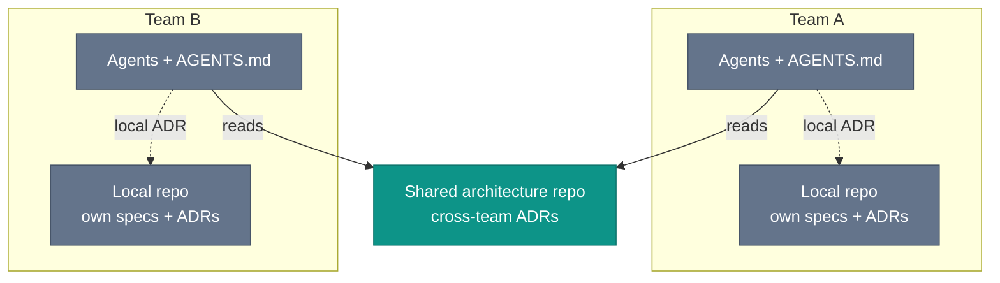

# Cross-Team Coordination

Consider two teams sharing an authentication boundary. Team A changes the token format and records the decision in an ADR marked Internal, inside Team A's repo. Team B's agents keep parsing the old format out of Team B's architecture docs because Team A's decision log never enters their context. Team B learns about the break the usual way, in production.

The ADR did its job for Team A. The mechanism that would have carried it to Team B did not exist.

Coordination across team boundaries adds a context problem. An agent working in Team B's repo may see Team B's architecture docs but miss a token-format decision recorded only in Team A's repo. The services share runtime behavior. Their repositories do not automatically share the decision record.

## ADRs as the cross-team mechanism

Architectural Decision Records are the cross-team primitive this book uses because they already exist in the SDLC. They are durable, human-readable, usually checked into a repo, and record decisions with consequences that persist after the authors have moved on.

For cross-team decisions, the ADR location matters. A record kept only in Team A's repository might be absent from Team B's working context. A shared architecture repository gives both teams one location to reference, provided each session can access and loads the relevant record.

The shared architecture repository pattern uses a repository, or subdirectory in a monorepo, for decisions affecting more than one team. Both teams' instructions point to it when a spec crosses the service boundary. Check that each agent setup has access and reads the token-format decision before work starts.

The mechanism is not new: it is the existing ADR practice applied at the organizational level rather than the team level. The agent-specific addition is a pre-spec context load from the shared repository.

*Sources: Michael Nygard, ["Documenting Architecture Decisions"](https://www.cognitect.com/blog/2011/11/15/documenting-architecture-decisions), November 15, 2011, ADRs as durable records of decisions and consequences. The shared-repository layout is this book's team-workflow synthesis.*

## Inner source for `.agents/` libraries

A team that has written useful skill files (a spec-quality checker, a test-strategy validator, a security-review skill) should not be the only team using them. The emerging pattern borrows from inner source: selected files from `.agents/` move into a shared library other teams pull from.

The mechanics resemble any shared library contribution. One team publishes the skill, documents what input it expects and what output it produces, and maintains it. Other teams pull or copy it into their `.agents/` directory.

One option is a `shared-agents` repository with skills and instruction files that teams reference from local `AGENTS.md` files. Each agent setup must be able to access the shared repository, and the developer should check which revision the session loaded. Project-specific rules stay local.

The inner-source pattern for agent instructions is book synthesis. Teams using it still need to decide how a shared file is versioned and how a consuming repository tests an update.

*Sources: AgentPatterns.ai, "AGENTS.md: Project-Level README for AI Coding Agents" (site review date September 19, 2026), AGENTS.md as a shared project instruction set. The inner-source distribution pattern for `.agents/` libraries is this book's synthesis.*

## Multi-repo realities

Consider a system with the payment, notification, and authentication services in separate repositories. Each has its own `openspec/` (if the team uses OpenSpec), `.agents/`, and project instructions. A change to their shared contract needs an explicit path across those repository boundaries.

Navigation happens through ADRs and through explicit cross-repo references in specs. A spec in the payment service that depends on a notification service API should reference the notification service's ADR for that API, not copy the API definition into the payment service spec. The reference is a pointer, and the ADR is the canonical record. When the API changes, the ADR updates. The payment service spec reference remains valid.

MCP (Model Context Protocol) creates another path: agents fetch context from other repositories on demand, rather than reading only their local files. As of mid-2026, this is an emerging practice. An agent working in the payment service might call an MCP tool to fetch the current API contract from the notification service repository. The pattern depends on the MCP tooling available.

The connector does not choose which contract governs a change. The developer still has to point the agent at the authoritative record and check the fetched revision. Without a connector, the developer may provide the relevant excerpt and link directly.

*Sources: Model Context Protocol documentation (ongoing), MCP as the agent-tool bridge used for external context fetches. The shared-context gap for multi-repo agent work is this book's synthesis from current tool limits.*

## Cross-repository planning still needs coordination

The book uses a separate proposal for each implementation ticket, including tickets in different repositories. OpenSpec's Stores beta offers a shared planning repository for work spanning repos. Its documentation still directs teams to keep independently scoped implementation changes in their component repos.

For a feature spanning repositories, coordinate the implementation tickets and their dependencies across teams. Each ticket has its own proposal referencing the agreed cross-cutting ADR. Create each proposal when its ticket starts. Verify the combined behavior in an environment shared by both teams.

*Sources: The ticket mapping and coordination sequence are this book's application of the author's team practice to cross-repository work.*

This reduces confusion, but it does not remove coordination. As of October 2026, the Stores beta does not route one shared task list to component repos or synchronize Git checkouts. Teams still have to link the implementation changes, sequence dependencies, and verify the combined behavior.

*Sources: Fission AI, ["Stores: Plan in Its Own Repo"](https://github.com/Fission-AI/OpenSpec/blob/main/docs/stores-beta/user-guide.md) (reviewed October 23, 2026), beta planning store, repo-local implementation changes, and limits on task routing and Git synchronization.*

## Governance without bureaucracy is still unsolved

The shared architecture repository pattern needs an owner. Without an index and review path, new ADRs accumulate while older decisions remain easy to mistake for current ones. The same maintenance problem affects a local decision log, but a shared log reaches more teams.

The alternative, where cross-team decisions are not written down, is the pattern behind the hypothetical production incident at the start of this chapter. The overhead of the shared repository is real. So is the cost of not having it.

The Stores beta gives teams a place for shared plans, but ownership of the contract and the order of component changes remain team decisions. A planning repository with no owner merely moves the drop folder.

*Sources: Fission AI, ["Stores: Plan in Its Own Repo"](https://github.com/Fission-AI/OpenSpec/blob/main/docs/stores-beta/user-guide.md) (reviewed October 23, 2026), shared planning store and its explicit coordination limits. Governance without bureaucracy is this book's open-problem framing.*
