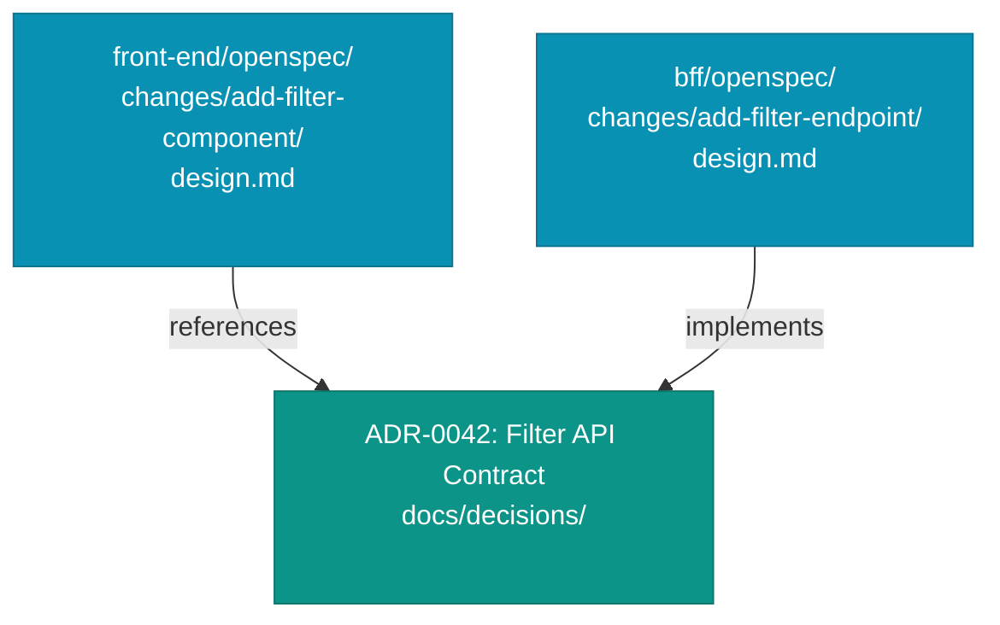

# OpenSpec Across Stacks

Consider a front-end agent given a monorepo without a clear tier boundary. It finds an API endpoint with the right name and method signature, then wires the new filter component directly to the back-end service. A review of the call path reveals the missing Backend for Frontend (BFF) authorization check.

This chapter addresses the missing tier boundary in the agent's working files. A single `openspec/` directory shared across three tiers puts their specs under one path and leaves tier ownership implicit.

## One `openspec/` per stack

For this workflow, give each stack (front-end, BFF, back-end) its own `openspec/` directory at the root of its repository, or of its subdirectory in a monorepo. Direct the front-end agent to its contract, acceptance criteria, and pending changes. Separate directories help scope the work, but the agent's actual inputs still depend on what the session loads.

```text
front-end/
  openspec/
    changes/
      add-filter-component/
        proposal.md
        design.md
        specs/
          filter-component/
            spec.md
        tasks.md

bff/
  openspec/
    changes/
      add-filter-endpoint/
        proposal.md
        design.md
        specs/
          filter-endpoint/
            spec.md
        tasks.md

back-end/
  openspec/
    changes/  # (unchanged by this feature)
```

A unified `openspec/` across stacks leaves the agent to sort through specs for three tiers when selecting the files for its task. Separate directories make tier ownership visible. The session still needs to load the relevant contract and change proposal.

*Sources: Fission AI, [OpenSpec](https://openspec.dev/) (ongoing), the change-folder model this per-stack layout builds on. The multi-tier split itself is this book's synthesis.*

## Front-end context belongs outside the stack spec

The spec pattern for front-end work is identical to the pattern for back-end work. What changes is the permanent context the agent reads before implementation.

A back-end agent reads `docs/architecture/`, the API contract, and the test strategy. A front-end agent reads the design system document instead: component conventions, accessibility requirements, and state management patterns. Figma or another design source supplies the visual context, while the design system document supplies the durable convention.

The spec should still cover behavior: states, validation, edge cases, loading, error, and empty states. User flows and navigation logic belong in `docs/architecture/`, referenced by the spec. The design system doc answers how the component should look when it renders correctly.

*Sources: Framelink, [Figma-Context-MCP](https://github.com/GLips/Figma-Context-MCP) (ongoing), Figma files as extractable design context for coding agents. The split between front-end behavior specs and a design-system document is this book's workflow mapping.*

## The integration contract belongs in an ADR

A change in the front-end spec that depends on a new BFF endpoint needs a contract shared by both stacks. This workflow records the cross-stack decision in an Architectural Decision Record (ADR), then links the separate change specs to it.

The ADR in `docs/decisions/` records the API contract: endpoint path, request shape, response shape, error handling, authentication boundary. Both stacks reference the same ADR in their respective change folders. The front-end spec says "see ADR-0042 for the BFF contract", while the BFF spec says "implements the contract in ADR-0042".

If the team changes the decision, record a superseding ADR and revise affected specs. The specs need not repeat the contract details.



The ADR stays among the current decisions while the change folders move to the archive after implementation. The contract remains available to later changes.

*Sources: Michael Nygard, ["Documenting Architecture Decisions"](https://www.cognitect.com/blog/2011/11/15/documenting-architecture-decisions), Cognitect blog, November 15, 2011, durable decision records and superseding a changed decision. Using an ADR for the cross-stack contract is this book's workflow choice.*

## When a change spans tiers

A new filter endpoint requires front-end work, BFF work, and sometimes back-end work. The temptation is to create one change folder that covers all three.

One folder makes tier ownership harder to see. The front-end agent does not need back-end implementation details to build its component, and the BFF reviewer needs the shared contract rather than every front-end acceptance criterion. Separate folders keep each review tied to the work its ticket owns.

For separately owned work across tiers, create a ticket for each implementation and link its proposal to the shared ADR. Coordinate ownership and dependencies in the ticket system. The shared decision records the contract each implementation must follow. [OpenSpec in an Existing SDLC](./openspec-in-existing-sdlc) explains the ticket mapping.

The rare exception: infrastructure changes that have no clean tier boundary. A change to how authentication tokens are propagated through the stack affects all three tiers simultaneously. These are genuinely cross-cutting and warrant a cross-cutting spec, but they are rare enough that the exception should be labeled as such, not treated as the default.

## This is book synthesis, not a field standard

Multi-tier spec organization is not a field standard. This pattern is the book's synthesis, derived from the OpenSpec change-folder model applied to multi-repo realities. Teams should expect to adapt it. A monorepo with shared libraries between front-end and back-end often needs a different boundary than the one described here. The principle is to scope the working set to the stack doing the work. The directory layout makes that boundary visible, while each session still has to select the right files.

A multi-tier layout settles where the specs live. It says nothing about where they fit. The team already has Jira, PR review, a changelog, and an architecture board, and now a directory of change folders that has to coexist with all of them. Knowing which slot each artifact belongs in is the difference between OpenSpec fitting the workflow and fighting it.
