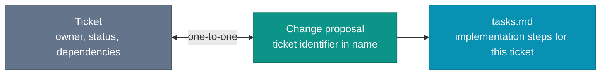

# OpenSpec in an Existing SDLC

A directory of change proposals does not tell the team who owns the next task or which dependency must finish first. In my team, the ticket system handles this coordination. Each developer's ticket identifies the work and links to its change proposal.

We use one change proposal per ticket. Agent instructions require the ticket identifier in the proposal's name, so the team has a direct way to connect assignment and status with the work in the repository. This is our working convention, not an OpenSpec requirement.

## One ticket, one change proposal

Break larger work into tickets before creating its proposals. Agree on ownership, dependencies, and the order of dependent tasks. A skill is an option for proposing this breakdown, with the team reviewing the resulting tasks and sequence.

Create the change proposal when the developer starts the ticket. The ticket supplies the intended outcome and relevant context. The proposal develops the acceptance criteria and implementation plan against the current code and documentation.



For example, a ticket named `PAY-142` might have a change proposal named `pay-142-add-retry-limit`. The prefix preserves the ticket identifier in the team's chosen naming format. Put the ticket link in the proposal and link back to the proposal from the ticket.

An illustrative instruction for the shared agent instructions is:

```text
When creating a change proposal, include the ticket identifier in its name.
Use the team's naming format and link the proposal to the ticket.
Keep the proposal scoped to that ticket's agreed work.
```

The one-to-one mapping applies to the tickets selected for implementation. A larger parent item groups those tickets. It does not need a separate proposal covering the same work. The mapping also leaves the number of pull requests (PRs) open: separate intent review and implementation review still concern the same ticket and proposal.

*Sources: The ticket mapping and naming rule are the author's reported team practice. The ticket identifier, proposal name, and instruction block are illustrative examples.*

## Implementation tasks are not team tickets

OpenSpec's Concepts documentation describes `tasks.md` as an implementation checklist inside the change folder. In our workflow, those steps belong to one ticket. Checking off a step does not complete a separate team assignment or authorize starting the next ticket.

For example, one ticket's checklist might cover the implementation, its rejection tests, and the affected documentation. Review the checklist against the acceptance criteria. The ticket system continues to carry ownership and dependencies, without duplicating each implementation checkbox on the board.

*Sources: Fission AI, ["Concepts"](https://github.com/Fission-AI/OpenSpec/blob/main/docs/concepts.md) (reviewed October 22, 2026), `tasks.md` as the change folder's implementation checklist. Its relationship to tickets is the author's team convention.*

## Finish one ticket before starting the next

In my team's sequence, a ticket is complete only after its implementation is verified and integrated and its change proposal is archived. [Spec Lifecycle](../spec-driven/spec-lifecycle) defines this completion condition. Only then does the developer start the next ticket and create its proposal from the updated repository.

Other developers continue on their own tickets in parallel. Coordinate shared interfaces and dependent tasks through the ticket system and the relevant design decisions. The sequence is per developer and respects dependencies, rather than making the whole team wait for one proposal.

*Sources: The completion rule and parallel team workflow are the author's reported practice.*

The ticket identifies who owns the change. Its branches and PRs must preserve the same scope while the work passes through review and integration.
