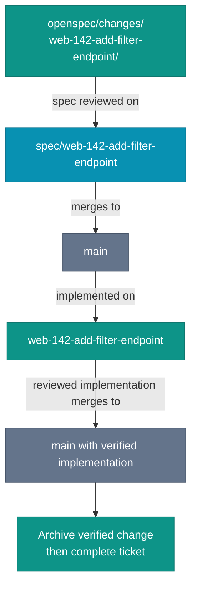

# Trunk-Based Development with Agents

The branch strategy predates coding agents by two decades. Paul Hammant has documented it since the early 2000s, and the core rule has not changed: commit to trunk frequently, keep feature branches short-lived, integrate continuously. The arguments for it are unchanged: early conflict detection, reduced merge pain, reliable CI signal. What has changed is what creates branches.

The ticket and change proposal identify the work. Branches carry the edits through review and integration. Keep those branches traceable to the same ticket without equating one proposal with one pull request (PR).

## Branches for one ticket and proposal

An OpenSpec change folder maps onto the branches that implement it. The change folder defines the scope. The branch is the vehicle. How many branches depend on one question: does the spec hold a decision worth locking before any code is written?

For a change with real intent to get right, such as business rules, edge cases, or an architectural choice, the spec rides its own PR first. The branch `spec/web-142-add-filter-endpoint` carries the change folder (`proposal.md`, `design.md`, delta specs, `tasks.md`) and no code. It is reviewed for intent, the acceptance criteria get corrected while correcting them is still cheap, and it merges. Then the implementation branch, named for the change folder slug, delivers the code against an already-approved spec.

The ticket remains open until the verified implementation is integrated and the folder is archived.

For a change whose intent is fully visible in the code diff, that split is pure ceremony. A bug fix, a mechanical refactor, a library bump like `Refactor observer to Jackson 3`: there is no acceptance criterion a reviewer would veto independently of the code, so locking the spec first buys nothing. One branch, one PR, spec delta and implementation together. Intent-first review still applies inside the single PR.

The test is not size, but whether an intent-level correction found during code review would force the implementation to be redone. If yes, the spec earns its own PR. If the only fix would be to the code, one PR is enough.

The rule covering both shapes is not a branch count. Every branch that traces back to this change folder carries its name and its scope, and nothing else rides along. The change folder is the unit of intent, and its branches are the units of delivery. A branch that folds in a second change folder's work is the violation, whether you used one branch or two.

*Sources: Paul Hammant, [trunkbaseddevelopment.com](https://trunkbaseddevelopment.com/) (ongoing) and "Trunk-Based Development and Branch by Abstraction" (Leanpub, 2020), short-lived branches and the trunk-based rule set the change-folder lifecycle maps onto. Dave Farley, "Modern Software Engineering" (Addison-Wesley, 2021), small changes integrated continuously.*

The example uses the proposal name `web-142-add-filter-endpoint` for ticket `WEB-142`. The ticket-number convention comes from [OpenSpec in an Existing SDLC](./openspec-in-existing-sdlc). A separate spec branch and implementation branch still serve one proposal.

## Integrate against the current repository

A branch remains open while colleagues change shared code and documentation. Before integrating, check whether those changes affect the proposal's assumptions. Resolve conflicting requirements as well as conflicting lines.

[Why Small?](../spec-driven/why-small) explains the author's move toward bounded tickets and proposals created as each ticket starts. A long-running branch is a reason to inspect changed dependencies and unfinished work. Duration alone does not establish where the work should be split.

*Sources: The ticket-to-branch mapping and integration checks are this book's workflow guidance.*

## Merge cadence with parallel changes

Each developer works on their own ticket and proposal while the team coordinates dependencies. If two tickets affect the same interface, agree on the intended contract and integration order. Record revised decisions where both developers and their agents will find them.

For work crossing repositories or tiers, give each separately owned implementation ticket its own proposal and identify the shared dependency. A parent ticket coordinates the larger outcome. Do not use one ticket identifier to imply several independently owned proposals are the same unit of work.

*Sources: The parallel ticket workflow is the author's team practice. Its application to cross-repository dependencies is this book's workflow guidance.*

## Instructions and completion

Put the ticket-number naming convention in the shared agent instructions, along with the applicable review and verification steps. Inspect the resulting proposal and branches rather than assuming the naming instruction was followed.

An open spec PR or completed `tasks.md` does not close the ticket. Keep the ticket active through implementation review and integration. Then archive the verified change and complete the ticket before starting the next one. [Spec Lifecycle](../spec-driven/spec-lifecycle#archive-before-completing-the-ticket) defines the completion condition.

*Sources: The naming and completion conventions are the author's reported practice, applied here to branches and PRs.*

## Review at merge

A clean code diff is the easiest thing for an agent to produce and the easiest thing for a reviewer to wave through. That is why review order matters. Read the diff first and the spec becomes confirmation. Read the spec first and the diff has to answer to it.

[Code Review for Agent-Generated Code](./code-review-agent-code) is the chapter that works out the mechanics. The point here is narrower: trunk-based flow gives that review order a natural place to happen, either in a spec PR of its own or at the top of a single PR before the code diff takes over the screen.

*Sources: Fission AI, [OpenSpec](https://openspec.dev/) (ongoing), the change folder and spec delta the review reads before the diff.*

## Trunk-Based Development is not universal, and neither is the two-PR shape

Trunk-based development is not universally practiced. Many teams use longer-lived feature branches, Gitflow variants, or release branches that stay open for weeks. The practices described here work best with short-lived branches. They do not require them. A team using a release-branch model still keeps each change folder's scope on its own branch and the spec-before-implementation discipline for decision-heavy changes. The branches live longer.

The argument for TBD over Gitflow is Hammant's to make, and he has made it thoroughly. This chapter does not re-argue it. It describes how OpenSpec change folders fit into TBD for teams that have already adopted it.

The two-PR shape for decision-heavy changes is this book's recommended default, not an industry standard. Plenty of teams ship spec and code in one PR and review the spec delta first inside it. That works, and it is lighter. The split earns its second PR when locking the intent before implementation would have saved a rework and costs ceremony when it would not. Treat it as a dial, not a mandate.

The one-change-per-developer rule contains the work in a reviewable unit. What happens when that unit reaches the review queue is a different workflow entirely.
